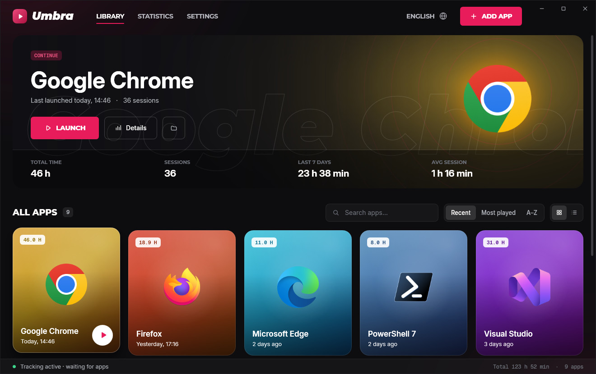
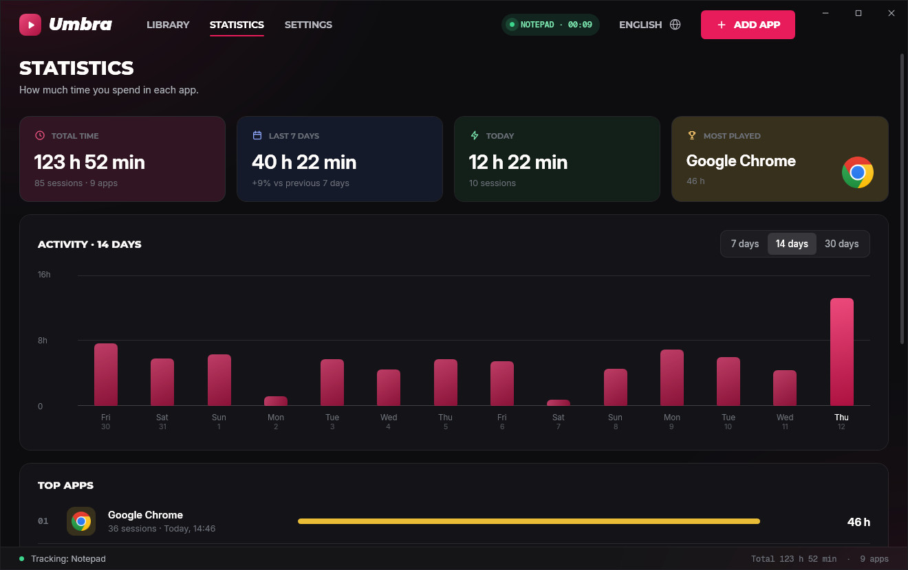
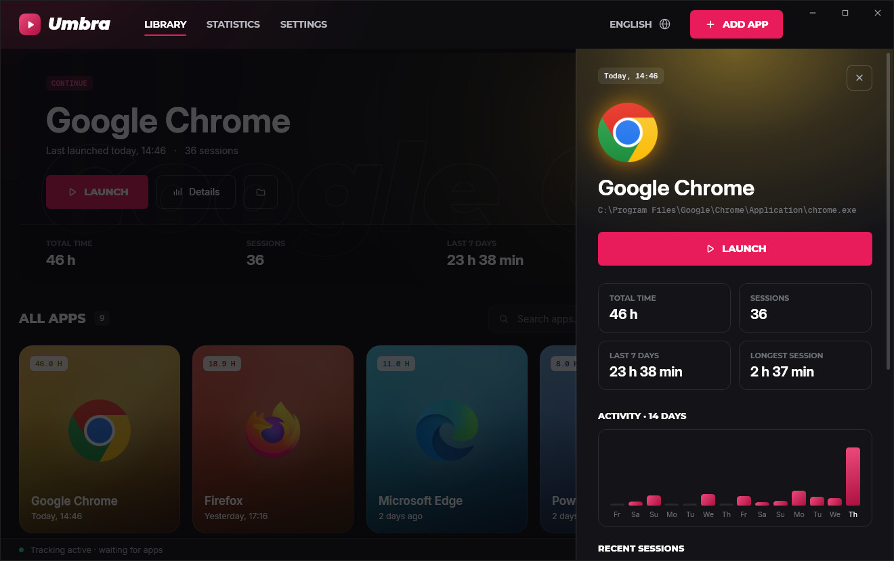
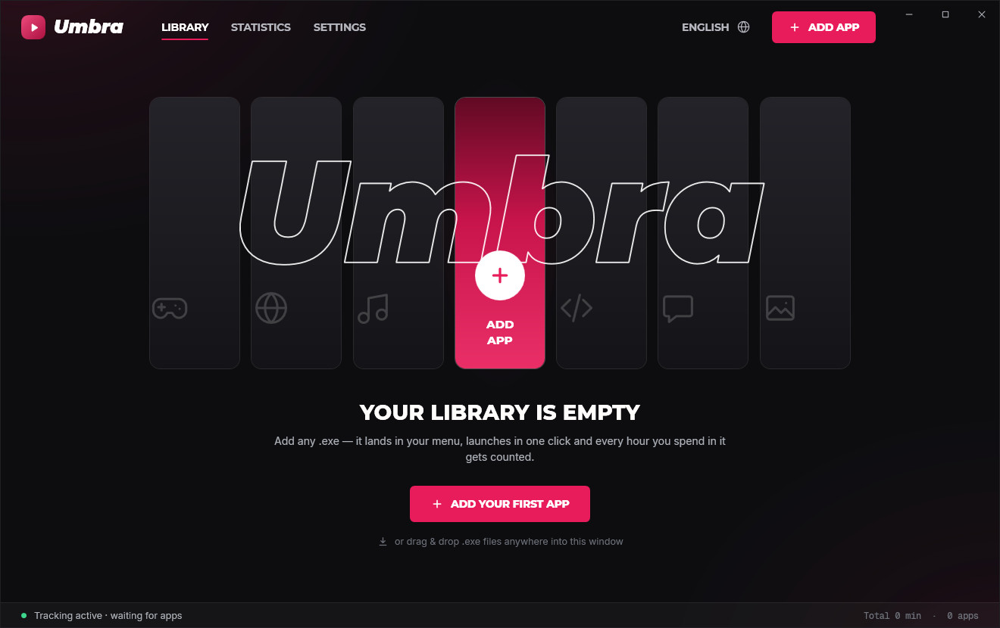
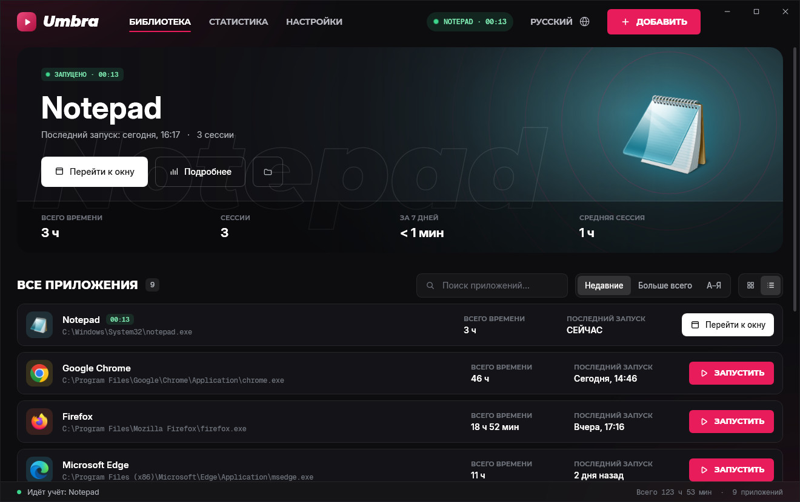

# Umbra Launcher

A personal launcher for any Windows program, styled after [majestic-rp.ru](https://majestic-rp.ru/) and [uc.zone](https://uc.zone/):
near-black canvas, hot-pink accent, heavy uppercase headings, hairline borders, gradient product cards with monospace badges.

Add any `.exe` (or a shortcut), launch it from the menu in one click, and the launcher counts how many hours you spend in each app.



| | |
| --- | --- |
|  |  |
|  |  |

<sub>Captured by the CI UI test on a Windows runner (real app, demo data).</sub>

## Run it

`UmbraLauncher.exe` is a single file. It runs on the .NET Framework 4.8 that ships with Windows 10 (1903+) and Windows 11, so
there is nothing to install: no runtime, no DLLs, no config file. Put the exe anywhere and double-click it.

Windows SmartScreen may warn about an unsigned download the first time; choose **More info → Run anyway**, or build it yourself (below).

## Features

- **Library menu** — add apps with **ADD APP** (file picker), by pasting a path, or by dragging `.exe` / `.lnk` files onto the window.
  Icons are pulled from the executables in high resolution and each card is tinted with the icon's own colour.
- **One-click launch** — from the card's play button, the banner, the details panel, the list view, or the tray icon's menu.
  Per-app launch arguments, working folder and *Run as administrator*.
- **Playtime tracking** — every session is recorded with its start, end and duration:
  - follows the launched process *and its child processes*, so launchers that start the real game and exit are still counted;
  - also counts apps started outside the launcher (desktop, Start menu) while the launcher runs in the tray (can be turned off);
  - optional *count only while the window is active* mode;
  - sleep/hibernate gaps are not counted, and an in-progress session survives a crash or power loss.
- **Statistics** — total time, last 7 days vs. the previous week, today, most-played app, a 7/14/30-day activity chart and a top-apps ranking.
  Each app also has a details panel with a 14-day chart and its recent sessions. Export everything to CSV.
- **Polish** — custom dark window chrome, English / Russian UI (switch from the top bar), six accent colours, a customisable launcher name,
  keyboard shortcuts (`Ctrl+N` add, `Ctrl+F` search, `Esc` close panels), start with Windows, minimise to tray.

## Where data lives

`%APPDATA%\UmbraLauncher\library.json` (plain JSON, with a rolling backup next to it).
For a portable setup, create a folder named `UmbraData` next to the exe and the launcher will keep its data there instead.
`--data <folder>` on the command line overrides both.

## Build from source

Requires the .NET SDK 8 or newer (Windows, macOS or Linux):

```
dotnet build launcher/src/UmbraLauncher.csproj -c Release
```

The output is `launcher/src/bin/Release/UmbraLauncher.exe`. On Linux/macOS the build works because the project sets
`EnableWindowsTargeting`; the exe itself only runs on Windows.

## Project layout

| Path | What's inside |
| --- | --- |
| `src/Services/PlaytimeTracker.cs` | Session tracking (process tree, install-folder matching, sleep gaps) |
| `src/Services/ProcessScanner.cs` | Fast Toolhelp process snapshot with cached image paths |
| `src/Services/IconService.cs` | 256 px shell icons with alpha, dominant colour |
| `src/ViewModels/` | Library, statistics, editor and per-app view models |
| `src/Views/`, `src/Themes/` | WPF views and the theme (palette, fonts, control styles, icons) |
| `src/Fonts/` | Inter, Montserrat and Geist Mono, subset to Latin + Cyrillic (SIL OFL, licences included) |
| `tests/ui-test.ps1` | End-to-end UI test run by CI on a Windows desktop |
| `tools/` | Scripts that generated the icon and the font subsets |

CI (`.github/workflows/launcher.yml`) builds the exe on Windows, adds Notepad through the UI, launches it, verifies that the
session time is recorded, and uploads screenshots plus the built `UmbraLauncher.exe` as artifacts.
